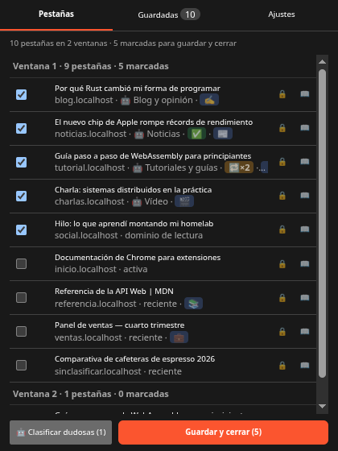
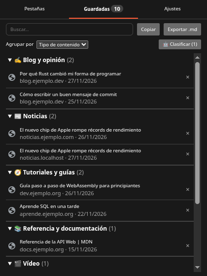

# Leer luego

> ⚠️ **Proyecto en desarrollo (WIP).** Funciona, pero está sin pulir y puede cambiar o fallar. No está publicado en ninguna tienda.

Extensión para Brave, Chrome y otros navegadores Chromium que evita que las pestañas se acumulen. Guarda como "leer luego" las que llevan días abiertas, las cierra sin que pierdas nada, y mantiene esa lista ordenada y sincronizada entre tus dispositivos.

  
  

## Qué hace

- **Propone qué guardar.** Lista las pestañas abiertas de todas tus ventanas y marca las que llevan varios días sin abrirse o son de webs que tú defines como "de lectura". Nunca propone las ancladas, en grupo, con audio, activas ni las protegidas.
- **Guardar y cerrar, sin riesgo.** Primero guarda la lista y solo si ha funcionado cierra las pestañas. Si dos son la misma página, se guarda una sola vez.
- **Tú decides.** Marcas o desmarcas cada pestaña, o fijas una regla para un dominio entero (🔒 nunca, 📖 siempre). Avisa de las duplicadas (🔁) y de las que ya están guardadas (✅).
- **Lista de guardadas** con buscador, agrupada por tipo de contenido, sitio o fecha. Copia las URL o expórtalas a Markdown.
- **Sincronizada entre dispositivos** mediante una carpeta de marcadores, que viaja con Brave Sync o Chrome Sync y se ve también en el móvil.
- **Popup o panel lateral**, a elegir. La lista se actualiza sola.

### Opcional (desactivado por defecto)

- **Clasificación con IA (OpenAI).** Etiqueta cada enlace por tipo de contenido (blog, noticias, tutorial, referencia…) y opina sobre las pestañas dudosas. Modo manual, con vista previa de lo que se envía, o automático.
- **Subcarpetas por tipo.** Organiza la carpeta de marcadores en `📰 Noticias`, `🧭 Tutoriales y guías`… Lo que mueves a mano, manda.
- **Categorías propias.** Crea las tuyas con nombre, emoji y una descripción que se le explica a la IA, o convierte en categoría tus subcarpetas con varios enlaces.
- **Aprendizaje.** Recuerda tus correcciones: si un dominio se repite, lo clasifica sin enviarlo a OpenAI, y usa tus ejemplos al preguntar. Lo ves y lo olvidas desde Ajustes.

## Instalación

No está en ninguna tienda: se carga sin empaquetar.

1. Clona o descarga este repositorio.
2. Abre `brave://extensions` (o `chrome://extensions`) y activa el **modo desarrollador**.
3. Pulsa **Cargar descomprimida** y elige la carpeta del proyecto.
4. Fija la extensión desde el icono del puzzle de la barra.

Hay que repetirlo en cada ordenador y en cada perfil del navegador: una extensión solo ve las pestañas de su propio perfil. Para actualizarla basta recargarla con la flecha circular de su tarjeta, sin reiniciar el navegador. Más detalles en [Primeros pasos](docs/primeros-pasos.md).

## Documentación

Todo está explicado en [`docs/`](docs/README.md):

| | |
|---|---|
| [Primeros pasos](docs/primeros-pasos.md) | Instalar, abrir, primera limpieza, actualizar. |
| [La vista Pestañas](docs/pestanas.md) | Cómo decide qué proponer y cómo corregirlo. |
| [La vista Guardadas](docs/guardadas.md) | Buscar, agrupar, abrir, copiar y exportar. |
| [Ajustes](docs/ajustes.md) | Cada ajuste, con su valor por defecto. |
| [Sincronización](docs/sincronizacion.md) | Marcadores, varios dispositivos y subcarpetas por tipo. |
| [Clasificación con IA](docs/ia.md) | Activarla, modos, qué se envía, costes y errores. |
| [Categorías propias y aprendizaje](docs/aprendizaje-y-categorias.md) | Adaptarla a ti y controlar lo que recuerda. |
| [Privacidad y permisos](docs/privacidad.md) | Qué sale de tu equipo y por qué se pide cada permiso. |
| [Solución de problemas](docs/problemas.md) | Síntomas habituales y qué hacer. |
| [Arquitectura](docs/arquitectura.md) | Para quien quiera tocar el código. |

## Privacidad, en pocas líneas

La extensión no tiene servidor propio ni analítica. Todo se guarda en local en tu navegador; la lista de guardadas solo sale del equipo, hacia la carpeta de marcadores, si tienes activada la sincronización.

La IA es opcional. Si la activas, se envía a OpenAI **solo el dominio y el título** de cada URL (nunca la ruta, los parámetros ni el contenido de la página), pidiendo que no conserve la respuesta. Con el aprendizaje activo, se envían también hasta 24 ejemplos tuyos, que ves y borras en Ajustes. La clave de API se guarda únicamente en el navegador donde la pegas y no se sincroniza: usa una clave de proyecto con límite de gasto.

Todos los detalles, y el motivo de cada permiso, en [Privacidad y permisos](docs/privacidad.md).

## Estado

**Probado en uso real** (en Brave, con dos ordenadores): guardar y cerrar, el panel lateral, la sincronización con marcadores, la organización por subcarpetas y la clasificación con una clave real de OpenAI.

**Probado solo con pruebas automatizadas** (marcadores reales en Chrome y un servidor que imita la API de OpenAI), todavía sin un uso prolongado: el aprendizaje y las categorías propias.

**Limitaciones conocidas**

- Las categorías propias y los ajustes **viven en cada navegador** y no se sincronizan. La subcarpeta de marcadores sí viaja: en otro equipo aparece como carpeta tuya que puedes convertir en categoría.
- Solo está soportada la API de **OpenAI**.
- Solo se guardan los **enlaces**, no el contenido de los artículos.
- Sin iconos propios todavía, y sin publicar en ninguna tienda de extensiones.
- Solo navegadores basados en Chromium.

## Desarrollo

JavaScript puro con módulos ES: sin compilación ni dependencias. Tras cambiar código, recarga la extensión desde la página de extensiones. La estructura y las decisiones de diseño están en [Arquitectura](docs/arquitectura.md) y en [`CLAUDE.md`](CLAUDE.md).

Todo cambio entra por pull request; `main` está protegido.
