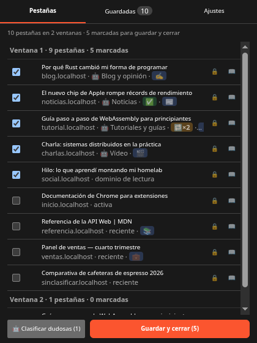

# Documentación de Leer luego

**Leer luego** es una extensión para Brave, Chrome y otros navegadores Chromium que evita que las pestañas se acumulen. Guarda como "leer luego" las que llevan días abiertas, las cierra sin que pierdas nada, y mantiene esa lista ordenada y sincronizada entre tus dispositivos.

El flujo básico son tres pasos:

1. **Abres la extensión** y ves tus pestañas abiertas con una propuesta: cuáles guardar y cuáles dejar.
2. **Ajustas** lo que no te cuadre (una casilla por pestaña) y pulsas **Guardar y cerrar**.
3. **Lees cuando quieras** desde la lista de *Guardadas*: ordenada por tipo de contenido, con buscador, y disponible también en tus otros equipos.

Lo demás es opcional: la clasificación con IA y la organización de los marcadores en subcarpetas vienen **desactivadas**, y el aprendizaje y las categorías propias se apoyan en ellas.

## Índice

| Documento | De qué trata |
|---|---|
| [Primeros pasos](primeros-pasos.md) | Instalar, abrir, primera limpieza, popup o panel lateral, actualizar. |
| [La vista Pestañas](pestanas.md) | Cómo decide la extensión qué proponer, los iconos, las reglas por dominio y el botón *Guardar y cerrar*. |
| [La vista Guardadas](guardadas.md) | Buscar, agrupar, abrir, quitar, copiar y exportar lo guardado. |
| [Ajustes](ajustes.md) | Referencia de cada ajuste, con su valor por defecto. |
| [Sincronización](sincronizacion.md) | Cómo viajan tus guardadas entre dispositivos y la organización en subcarpetas por tipo. |
| [Clasificación con IA](ia.md) | Activar OpenAI, modos manual y automático, qué se envía, costes y avisos. |
| [Categorías propias y aprendizaje](aprendizaje-y-categorias.md) | Crear tus categorías, cómo aprende de tus correcciones y cómo olvidarlo. |
| [Privacidad y permisos](privacidad.md) | Qué datos salen de tu equipo, cuándo y por qué se pide cada permiso. |
| [Solución de problemas](problemas.md) | Qué hacer cuando algo no funciona, con los mensajes de error más habituales. |
| [Arquitectura](arquitectura.md) | Para quien quiera tocar el código: estructura, datos guardados y decisiones de diseño. |

## Convenciones

| Icono | Significado |
|---|---|
| 🔒 | Este dominio no se propone nunca para cerrar. |
| 📖 | Este dominio siempre se propone como "leer luego". |
| 🔁×2 | La misma página está abierta en varias pestañas (el número es cuántas). |
| ✅ | La página ya está en *Guardadas*. |
| 🤖 | Lo propone o etiqueta la IA. |
