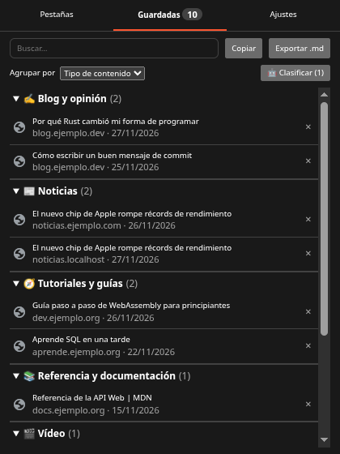
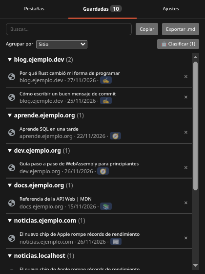

# La vista Guardadas

Aquí está todo lo que has guardado para leer luego. El número junto al título de la pestaña indica cuántos enlaces hay.



## Qué puedes hacer

| Acción | Cómo |
|---|---|
| **Abrir un enlace** | Haz clic en su título. Se abre en una pestaña nueva y **se quita de la lista**: se considera leído. |
| **Quitar sin abrir** | Pulsa la ✕ de la derecha. |
| **Buscar** | Escribe en el cuadro de búsqueda. Filtra por título y por dominio. |
| **Agrupar** | Elige el criterio en *Agrupar por* (ver abajo). Se recuerda. |
| **Plegar un grupo** | Haz clic en su cabecera. Se mantiene plegado mientras tengas abierta la extensión. |
| **Copiar las URL** | Botón **Copiar**: pone en el portapapeles todas las URL, una por línea. |
| **Exportar** | Botón **Exportar .md**: descarga un archivo Markdown. |
| **Clasificar** | Botón **🤖 Clasificar (N)**, solo con la [IA](ia.md) activada en modo manual y enlaces sin categoría. |

**Copiar** y **Exportar** incluyen **todas** las guardadas, no solo las que ves filtradas por la búsqueda.

El archivo exportado se llama `leer-luego-AAAA-MM-DD.md` y tiene una línea por enlace:

```markdown
- [Guía paso a paso de WebAssembly](https://dev.ejemplo.org/wasm) — dev.ejemplo.org, 2026-11-26
```

Si guardas el mismo enlace dos veces, no se duplica: se compara por su dirección normalizada (sin `www`, ancla, barra final ni parámetros de rastreo).

## Agrupar

| Criterio | Cómo agrupa |
|---|---|
| **Tipo de contenido** (por defecto) | Por la categoría que la [IA](ia.md) o tú habéis asignado: Blog y opinión, Noticias, Tutoriales… Lo que aún no tiene categoría va a **Sin clasificar**, al final. Las categorías van en el orden de la lista de [Ajustes](ajustes.md). |
| **Sitio** | Por dominio, con los dominios que más enlaces tienen primero. |
| **Fecha** | `Hoy`, `Esta semana`, `Este mes` y `Antes`. |
| **Sin agrupar** | Una lista plana, de más reciente a más antigua. |

Cada cabecera muestra cuántos enlaces tiene el grupo. Cuando no se agrupa por tipo, cada enlace muestra además el emoji de su categoría, si la tiene.



## De dónde sale la categoría

- Si la [IA](ia.md) está activada, clasifica los enlaces nuevos (en el momento que tú elijas) y la categoría se guarda por dirección.
- Si tienes la [organización por subcarpetas](sincronizacion.md#organizar-por-tipo-de-contenido) activada, la categoría también se lee de la carpeta de marcadores donde esté el enlace. Así viaja entre tus equipos.
- Sin IA y sin subcarpetas, todo queda en **Sin clasificar**; puedes seguir agrupando por sitio o por fecha.

## Iconos

Los enlaces que llegan desde otro dispositivo no traen icono propio: se usa el que tiene guardado el navegador para esa web.
