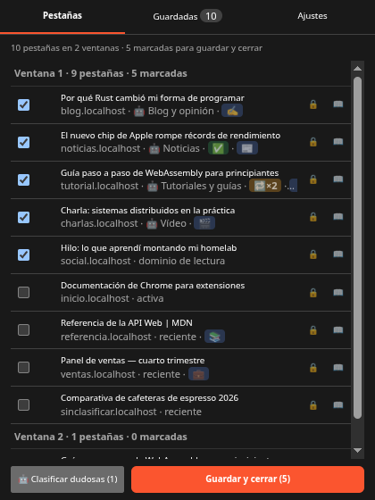

# La vista Pestañas

Es la pantalla principal. Muestra todas las pestañas abiertas en las ventanas de tu perfil, agrupadas por ventana, y propone cuáles guardar para leer luego y cerrar.

## Qué ves

- **Resumen**, arriba: cuántas pestañas hay, en cuántas ventanas y cuántas están marcadas.
- **Un encabezado por ventana**: `Ventana 1 · 9 pestañas · 5 marcadas`. Dentro de cada ventana, las marcadas salen primero.
- **Una fila por pestaña**, con su casilla, su icono, el título, el dominio y el motivo de la propuesta.
- **Botón *Guardar y cerrar (N)***, abajo. Si no hay nada marcado, está desactivado.
- **Botón *🤖 Clasificar dudosas***, solo si tienes la [IA](ia.md) activada en modo manual y hay pestañas pendientes.

La lista se actualiza sola cuando abres, cierras, mueves o cambias pestañas, o cierras una ventana. No tienes que reabrir la extensión.

## Cómo decide qué proponer

La extensión aplica estas reglas **en este orden**, y se queda con la primera que se cumpla:

| # | Regla | Resultado | Motivo que se muestra |
|---|---|---|---|
| 1 | No es una página web (`brave://…`, `chrome://…`, `about:blank`…) | No se puede guardar | `página interna` |
| 2 | Está anclada | Se mantiene | `anclada` |
| 3 | Está en un grupo de pestañas | Se mantiene | `en un grupo` |
| 4 | Está sonando | Se mantiene | `con audio` |
| 5 | Es la pestaña activa de su ventana | Se mantiene | `activa` |
| 6 | Su dominio está en *Dominios que nunca se proponen* | Se mantiene | `dominio protegido` |
| 7 | Su dominio está en *Dominios que siempre son "leer luego"* | Se marca | `dominio de lectura` |
| 8 | Lleva sin abrirse al menos *N* días (por defecto 3) | Se marca | `sin abrir hace 4 d` |
| 9 | Ninguna de las anteriores | Se mantiene, y se considera **dudosa** | `reciente` |

Las pestañas **dudosas** (regla 9) son las únicas sobre las que puede opinar la [IA](ia.md): si está activada, las etiqueta por tipo de contenido y, cuando está suficientemente segura de que son para leer más tarde, las marca. Las demás las deciden siempre las reglas.

Las páginas internas no se pueden marcar: su casilla está desactivada.

## Iconos y etiquetas de cada fila

| Etiqueta | Significado |
|---|---|
| `🔁×2 (ventana 1, 3)` | La misma página está abierta 2 veces, en las ventanas indicadas. Al pasar el ratón por encima ves el detalle. Se comparan por la dirección normalizada: da igual el `www`, el `http`/`https`, la ancla `#…`, la barra final o los parámetros de rastreo (`utm_*`, `fbclid`, `gclid`…). |
| `✅` | Esa página ya está en *Guardadas*. Cerrarla no añade nada nuevo. |
| `🤖 Blog y opinión` (en el motivo) | La IA ha propuesto guardarla, con ese tipo de contenido. |
| Un emoji suelto (✍️, 📰, 🧭…) | Tipo de contenido que la IA ha asignado a esa URL. Al pasar el ratón ves su nombre. |

## Corregir una propuesta

- **Una pestaña concreta:** marca o desmarca su casilla. Tu decisión manda sobre la propuesta.
- **Un dominio entero:** usa los botones de la derecha de la fila.
  - **🔒** añade el dominio a *Dominios que nunca se proponen*.
  - **📖** lo añade a *Dominios que siempre son "leer luego"*.

  La regla se aplica al instante a todas las pestañas de ese dominio y se guarda. Pulsar el contrario cambia la regla. Puedes verlas y editarlas en [Ajustes](ajustes.md).

Si la IA está activada, tus decisiones también sirven para que [aprenda](aprendizaje-y-categorias.md).

## Guardar y cerrar

Al pulsar **Guardar y cerrar (N)**:

1. Se guardan las N pestañas marcadas en *Guardadas*, sin repetir las que ya estaban (se comparan por la dirección normalizada).
2. **Solo si ese guardado ha funcionado**, se cierran las pestañas.
3. Si cerrar las pestañas dejara una ventana vacía, se abre una pestaña nueva en ella para que la ventana no se cierre.
4. Aparece un mensaje, por ejemplo `4 cerradas · 3 guardadas (el resto ya estaba)`.

Si algo falla al guardar, no se cierra nada y se avisa con `Error al guardar. No se ha cerrado nada.`

Si tienes la [sincronización](sincronizacion.md) activada, los enlaces guardados aparecen también como marcadores en la carpeta "Leer luego".
